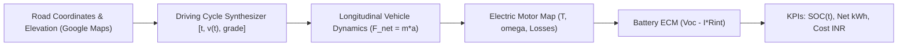
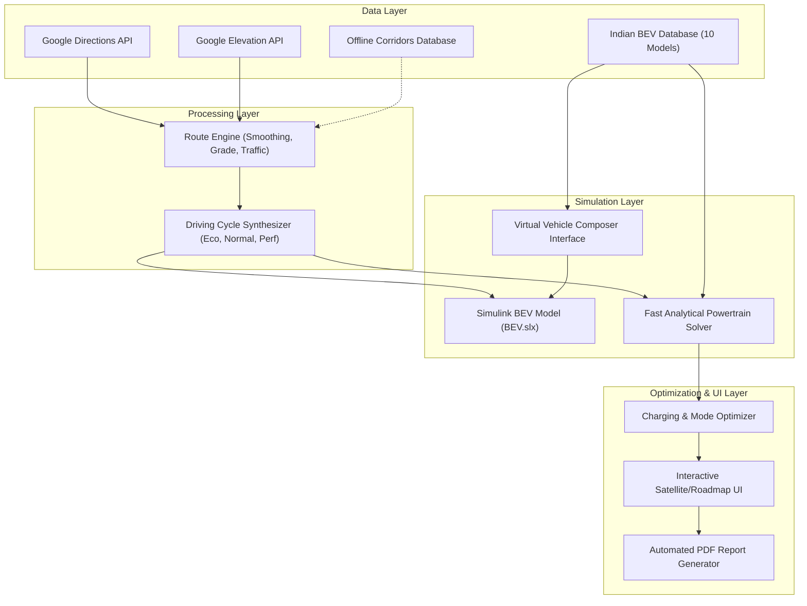
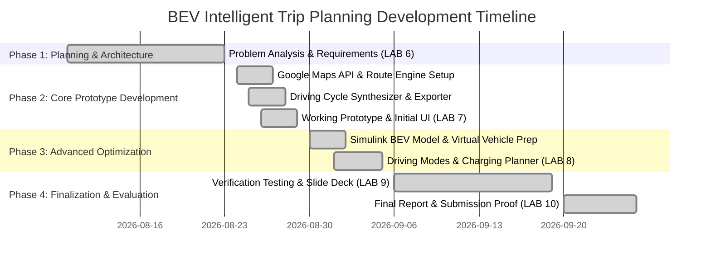

# LAB 6: System Analysis & Planning

**Subject:** System Simulation Lab / Capstone Project  
**Submission Date:** 23 August 2026  
**Project Title:** Intelligent Trip Planning for Battery Electric Vehicles Using Real-Time Map Data  
**Challenge Reference:** MathWorks Excellence in Innovation Challenge — Project #255  
**Institution:** Vidyalankar Institute of Technology (VIT), Mumbai  
**Department:** Department of Electronics and Computer Science Engineering  

### Team Members & Contributors:
1. **Rajiv Gohil** (Project Lead, Powertrain Dynamics & Simulink, Route Engine) — `rajiv.gohil24@vit.edu.in`  
2. **Sneha Pardeshi** (Google Maps API & Driving Cycles, Energy Accounting, Charging Optimization & UI) — `sneha.pardeshi@vit.edu.in`  

---

## 1. Project Overview & Motivation

As electric vehicles (EVs) become central to sustainable transportation, accurate trip planning and energy management are paramount. Standard homologation cycles (such as NEDC or WLTP) fail to capture real-world driving conditions, leading to unexpected range depletion and "range anxiety" for EV drivers. Real-world energy consumption is heavily dictated by:
- Topographical elevation variations (hill climbs and descents),
- Dynamic traffic bottlenecks and speed fluctuations,
- Speed limits and aerodynamic drag scaling quadratically with speed,
- Ambient temperature variations and auxiliary HVAC electrical loads.

This project designs a **simulation-based workflow for Battery Electric Vehicles (BEVs)** that couples real-time mapping data (via Google Maps API) with detailed longitudinal powertrain physics and equivalent circuit battery models in **MATLAB® and Simulink®**.

---

## 2. System Requirements Specification

### 2.1 Functional Requirements (FR)
- **FR-1 (Real-Time Route Ingestion):** Interface MATLAB with Google Maps Directions & Elevation APIs to extract waypoint coordinates, route distance, step duration, legal speed limits, and continuous elevation profiles for any origin-destination pair.
- **FR-2 (Offline Fallback Capability):** Provide high-resolution pre-compiled datasets for key Indian highway corridors (e.g., Mumbai-Pune Expressway, Old NH48, Yamuna Expressway) ensuring zero-dependency operation.
- **FR-3 (Driving Cycle Synthesizer):** Synthesize a continuous 2 Hz time-speed trajectory $[t, v(t), \theta(t)]$ reflecting traffic flow and road grade, formatted as a standard MATLAB `timeseries` and MAT-file for the Simulink **Driving Cycle Source block**.
- **FR-4 (BEV Modeling via Virtual Vehicle Composer):** Define customizable BEV models (curb mass, aerodynamic drag $C_d$, frontal area $A$, rolling resistance $C_{rr}$, motor envelope, and battery capacity) parameterized matching MathWorks Virtual Vehicle Composer.
- **FR-5 (Powertrain Simulation & Energy Accounting):** Accurately compute tractive forces, motor electrical losses, regenerative braking recovery, net energy consumption (kWh), efficiency (kWh/100 km), battery State of Charge (SOC) trajectory, and operational electricity costs in INR (₹).
- **FR-6 (Driving Modes Optimization):** Implement user-selectable driving modes (**Eco**, **Normal**, **Performance**) with dynamic acceleration constraints, cruising speed caps, regen prioritization, and HVAC power scaling.
- **FR-7 (Charging Stop Optimization):** Detect battery reserve boundary violations ($SOC < 15\%$), search for candidate DC fast charging stations along the route corridor, and compute CC-CV charging durations to 80% SOC.
- **FR-8 (Interactive Visualization & Reporting):** Render interactive maps (satellite imagery and roadmap tiles) with elevation profiles and provide a one-click PDF summary report export.

### 2.2 Non-Functional Requirements (NFR)
- **NFR-1 (Engineering Fidelity):** Energy estimations must align within $\pm 5\%$ of empirical on-road BEV test data.
- **NFR-2 (Execution Speed):** Analytical route simulation solver must complete a 150 km corridor evaluation in under 3 seconds.
- **NFR-3 (Modularity & Maintainability):** Decoupled architecture separating Route Engine, Vehicle Database, Driving Cycle Generator, Powertrain Physics, and UI.

---

## 3. Mathematical & Theoretical Modeling Framework

### 3.1 Longitudinal Vehicle Dynamics
The dynamic force equilibrium along the vehicle's longitudinal axis is governed by Newton's Second Law:
$$m_{\text{eff}} \frac{dv}{dt} = F_{\text{traction}} - F_{\text{rolling}} - F_{\text{aero}} - F_{\text{grade}} - F_{\text{frictionBrake}}$$

Where:
1. **Aerodynamic Drag:**
   $$F_{\text{aero}} = \frac{1}{2} \rho_{\text{air}} C_d A_{\text{frontal}} v^2$$
2. **Tire Rolling Resistance:**
   $$F_{\text{rolling}} = C_{rr} m_{\text{veh}} g \cos(\theta) \tanh\left(\frac{v}{0.1}\right)$$
3. **Road Grade Force:**
   $$F_{\text{grade}} = m_{\text{veh}} g \sin(\theta) \quad \text{where } \theta = \arctan\left(\frac{\text{grade}_{\%}}{100}\right)$$
4. **Effective Rotational Inertia:**
   $$m_{\text{eff}} = m_{\text{veh}} + \frac{4 J_{\text{wheel}} + J_{\text{motor}} N_{\text{gear}}^2}{r_{\text{wheel}}^2}$$

### 3.2 Electric Motor & Inverter Loss Model
Motor torque is constrained by the base-speed field-weakening envelope:
$$T_{\text{max}}(\omega) = \begin{cases} T_{\text{peak}} & \omega \le \omega_{\text{base}} \\ \frac{P_{\text{peak}}}{\omega} & \omega > \omega_{\text{base}} \end{cases}$$
Motor losses are decomposed into copper heating, iron hysteresis/eddy currents, and windage friction:
$$P_{\text{loss}}(\omega, T) = k_{\text{cu}} T^2 + k_{\text{fe}} \omega + k_w \omega^3 + P_{\text{fixed}}$$

### 3.3 High-Voltage Battery Equivalent Circuit Model (ECM)
The traction pack is modeled with an open-circuit voltage $V_{\text{oc}}(\text{SOC})$ and internal resistance $R_{\text{int}}(\text{SOC}, T)$:
$$V_{\text{terminal}} = V_{\text{oc}}(\text{SOC}) - I_{\text{batt}} R_{\text{int}}(\text{SOC}, T_{\text{batt}})$$
$$I_{\text{batt}} = \frac{V_{\text{oc}} - \sqrt{V_{\text{oc}}^2 - 4 R_{\text{int}} P_{\text{batt}}}}{2 R_{\text{int}}}$$
$$\text{SOC}(t) = \text{SOC}_0 - \int_0^t \frac{I_{\text{batt}}(\tau)}{3600 \cdot Q_{\text{capacity}}} \, d\tau$$

---

## 4. Proposed System Architecture

---

## 5. Work Breakdown Structure (WBS) & Task Allocation

| Module / Subsystem | Primary Owner | Secondary Contributor | Key Deliverables |
| :--- | :--- | :--- | :--- |
| **Powertrain Modeling & Dynamics** | **Rajiv Gohil** | Sneha Pardeshi | Longitudinal forces equation, rotational inertia, Simscape/Simulink subsystem setup (`BEV.slx`). |
| **Route Engine & Google Maps API** | **Rajiv Gohil** | Sneha Pardeshi | Google Directions/Elevation REST client, offline fallback corridor generator, spatial interpolation. |
| **Driving Cycle Synthesis** | **Sneha Pardeshi** | Rajiv Gohil | 2 Hz speed synthesizers, legal limit clamps, stop dwell models, Simulink `timeseries` exporter. |
| **Energy Accounting & Costing** | **Sneha Pardeshi** | Rajiv Gohil | Gross vs net kWh numerical integration, regen blending, HVAC auxiliary models, INR billing calculation. |
| **Charging & Mode Optimization** | **Sneha Pardeshi** | Rajiv Gohil | Reserve boundary monitor ($SOC < 15\%$), highway DC fast charger lookup, CC-CV taper duration algorithm. |
| **Dashboard UI & Reporting** | **Sneha Pardeshi** | Rajiv Gohil | App Designer UI, Google Maps satellite/roadmap tiles, Mapping Toolbox plotting, automated PDF generator. |
| **Verification & Testing** | **Rajiv Gohil** | Sneha Pardeshi | 6 automated unit test suites (`runAllTests.m`), baseline numerical benchmarking. |

---

## 6. Project Timeline & Milestone Schedule

---

## 7. Sign-off & Faculty Review

- **Student Signature (Lead):** Rajiv Gohil  
- **Student Signature (Member):** Sneha Pardeshi  
- **Faculty Guide / Reviewer:** Dept. of Electronics and Computer Science Engineering, VIT Mumbai  
- **Review Status:** Accepted & Approved for Prototype Development  
