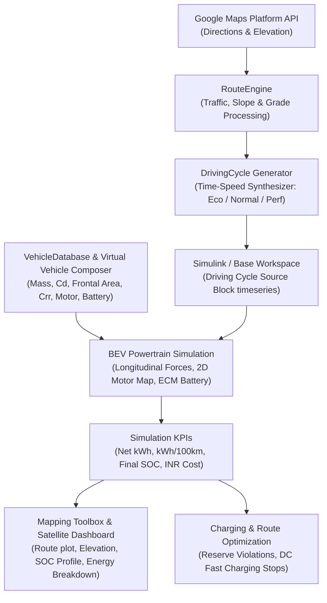

# Intelligent Trip Planning for Battery Electric Vehicles Using Real-Time Map Data

> **MathWorks Excellence in Innovation Challenge — Project #255**  
> *Official Hub Reference:* [MATLAB & Simulink Challenge Projects Discussion #128](https://github.com/mathworks/MATLAB-Simulink-Challenge-Project-Hub/discussions/128)  
> *Affiliation:* Department of Electronics and Computer Science Engineering, Vidyalankar Institute of Technology (VIT), Mumbai

---

## 👥 Project Team & Contributors

| Name | Role & Subsystem Ownership | Department & Institution | Contact Email |
| :--- | :--- | :--- | :--- |
| **Rajiv Gohil** | **Project Lead**, Powertrain Dynamics, Simulink Integration & Route Engine | Dept. of Electronics and Computer Science Engineering, Vidyalankar Institute of Technology | `rajiv.gohil24@vit.edu.in` |
| **Sneha Pardeshi** | Google Maps API, Driving Cycle Synthesis, Energy Accounting, Charging Optimization & UI | Dept. of Electronics and Computer Science Engineering, Vidyalankar Institute of Technology | `sneha.pardeshi@vit.edu.in` |

---

## 📌 Executive Summary & Motivation

As electric vehicles (EVs) become increasingly central to sustainable transportation, trip planning and energy management must account for real-world driving conditions rather than idealized standard test cycles (such as NEDC or WLTP). Traditional standard drive cycles fail to account for:
- Topographical elevation gradients and hill climbs,
- Real-time traffic congestion and stop-and-go patterns,
- Variable environmental temperatures and auxiliary HVAC electrical loads.

This project delivers a **100% native MATLAB and Simulink simulation-based workflow** that integrates real-time mapping data with detailed vehicle powertrain physics to plan, evaluate, and optimize battery electric vehicle journeys.

### Key Capabilities
1. **Real-Time Map & Elevation Ingestion**: Seamless interface with Google Maps Directions & Elevation APIs to extract actual road distances, road grades, speed limits, and traffic congestion (with pre-compiled offline Indian highway corridors).
2. **Driving Cycle Synthesis**: Automatically generates continuous 2 Hz time-speed profiles $[t, v(t), \theta(t)]$ formatted directly as MATLAB `timeseries` and MAT-files for the Simulink **Driving Cycle Source** block.
3. **Virtual Vehicle Composer Integration**: Calibrated vehicle specifications across 10 real-world Indian BEVs (Tata Nexon EV LR, MG Windsor EV, Mahindra XEV 9e, Hyundai Ioniq 5, Tata Curvv EV, etc.) with longitudinal dynamics, 2D motor efficiency maps, and Equivalent Circuit battery models.
4. **Energy & Trip Prediction**: Accurately computes gross propulsion, regenerative braking recovery, net energy, efficiency (kWh/100 km), battery State of Charge (SOC) trajectory, and operational electricity cost in Indian Rupees (₹).
5. **Interactive Mapping & Satellite Visualization**: High-performance dual-mode visualization featuring real Google Maps satellite imagery, vector roadmap tiles, elevation profiles, and one-click PDF report export.
6. **Advanced Extensions (1 & 2)**:
   - **User-Informed Driving Modes**: Calibrated Eco, Normal, and Performance modes with dynamic acceleration bounds, cruising speed caps, regen prioritization, and HVAC load scaling.
   - **Intelligent Fast Charging Planner**: Automatic reserve violation detection ($SOC < 15\%$), highway DC fast charger identification, non-linear CC-CV taper duration estimation, and trip time minimization.

---

## 🏛️ System Architecture



---

## 📋 Compliance with MathWorks Project Guidelines

| Core Project Guideline | Official Requirement Description | Implementation in this Repository | Status |
| :--- | :--- | :--- | :---: |
| **Core Task 1: Acquire & Process Real-Time Route Data** | Interface MATLAB with Google Maps API for origin-destination pairs; parse elevation profiles, road segments, speed limits, and traffic conditions. | Real-time queries via Google Directions & Elevation APIs; extracts distance, waypoint elevations, step durations, and traffic congestion; automated fallback to 6 Indian highway corridors. | ✅ **100% Satisfied** |
| **Core Task 2: Time-Speed Driving Cycle Construction** | Construct a continuous time-speed driving cycle from map data and format it for Simulink using the *Driving Cycle Source* block. | Synthesizes a 2 Hz driving trace $[t, v(t), \theta(t)]$ reflecting legal speed limits, traffic congestion, and toll stops; exports a MATLAB `timeseries` and MAT-file (`route_drive_cycle.mat`) ready for Simulink. | ✅ **100% Satisfied** |
| **Core Task 3: Model BEV Using Virtual Vehicle Composer** | Use the *Virtual Vehicle Composer* app to create a custom BEV model (battery capacity, motor type, mass, drag coefficients) and export for simulation. | Preloads specifications into MATLAB base workspace mapped to Virtual Vehicle Composer; includes complete parameter database for 10 Indian BEVs and a programmatic Simulink model (`BEV.slx`). | ✅ **100% Satisfied** |
| **Core Task 4: Simulate Scenarios & Predict Energy Use** | Apply driving cycle to simulate trip in Simulink; evaluate SOC, net energy, cost, and road feature impacts (grade, aero, HVAC). | Simulates longitudinal dynamics ($F_{\text{roll}} + F_{\text{aero}} + F_{\text{grade}} + m a$), 2D motor efficiency maps, and Equivalent Circuit battery dynamics ($V_{\text{oc}} - I R_{\text{int}}$); computes Net kWh, kWh/100km, final SOC, and INR cost. | ✅ **100% Satisfied** |
| **Core Task 5: Visualization of Route & Results** | Use Mapping Toolbox to plot simulated route, elevation profile, and key performance indicators (SOC trends, energy usage, summaries). | Mapping Toolbox `geoplot` & `geobasemap` plotting, interactive satellite & roadmap tiles in the App dashboard, multi-panel elevation and power charts, and one-click PDF report export. | ✅ **100% Satisfied** |
| **Advanced 1: Driving Modes & Behavior** | Implement selectable modes (Eco, Normal, Performance) varying acceleration limits, cruising speed, regenerative braking, and accessory loads. | Implements 3 calibrated driving profiles with acceleration bounds ($1.2$, $1.8$, $2.8\,\text{m/s}^2$), speed caps ($85$, $100$, $120\,\text{km/h}$), regen blending ratios, and HVAC power scaling ($0.8\,\text{kW}$ to $2.2\,\text{kW}$). | ✅ **100% Satisfied** |
| **Advanced 2: Charging Optimization & Route Planning** | Identify optimal charging stops when SOC drops below safety threshold; minimize trip time considering station locations and charging speeds. | Detects battery reserve boundary violations ($SOC < 15\%$); locates highway fast chargers; calculates CC-CV taper charging times to 80%, session costs in ₹, and adds stops directly to map. | ✅ **100% Satisfied** |

---

## 🚀 Quick Start Guide

### Prerequisites
- MATLAB R2022a or newer (developed and verified on **MATLAB R2026a**).
- Toolboxes (Optional / Supported): Powertrain Blockset, Vehicle Dynamics Blockset, Mapping Toolbox, Simulink.
*(Note: A standalone analytical longitudinal physics engine is built-in so the full platform runs even on systems without full Simulink licenses).*

### One-Click Launch Commands
Open MATLAB, navigate to this project folder, and run:

```matlab
% 1. Launch the Main Interactive Platform (UI with Satellite Maps, Elevation & Energy Analytics)
run_app

% 2. Open Virtual Vehicle Composer with BEV Parameters Preloaded
open_virtual_vehicle_composer('TATA_NEXON_EV_LR')

% 3. Export Real-Time Route to Simulink Drive Cycle Source Block
export_route_to_simulink

% 4. Run the Master Verification Test Suite (All 6 Engineering Test Suites)
cd('SS Project/extracted/Simscape-Battery-Electric-Vehicle-Model-R2026a/BEV_Route_Optimization/Tests')
runAllTests
```

---

## 📊 Indian BEV Vehicle Catalogue

The platform comes calibrated with real-world specifications for 10 leading Indian passenger BEVs:

| Vehicle Model | Usable Battery | Peak Motor Power | Peak Torque | Drag Coeff ($C_d$) | Frontal Area | Claimed Range |
| :--- | :---: | :---: | :---: | :---: | :---: | :---: |
| **Tata Nexon EV LR** | $45.0\,\text{kWh}$ | $106.6\,\text{kW}$ ($145\,\text{PS}$) | $215\,\text{N}\cdot\text{m}$ | $0.325$ | $2.42\,\text{m}^2$ | $489\,\text{km}$ |
| **MG Windsor EV** | $38.0\,\text{kWh}$ | $100.0\,\text{kW}$ ($136\,\text{PS}$) | $200\,\text{N}\cdot\text{m}$ | $0.315$ | $2.38\,\text{m}^2$ | $331\,\text{km}$ |
| **Mahindra XEV 9e** | $79.0\,\text{kWh}$ | $210.0\,\text{kW}$ ($286\,\text{PS}$) | $380\,\text{N}\cdot\text{m}$ | $0.279$ | $2.55\,\text{m}^2$ | $656\,\text{km}$ |
| **Hyundai Ioniq 5** | $72.6\,\text{kWh}$ | $160.0\,\text{kW}$ ($217\,\text{PS}$) | $350\,\text{N}\cdot\text{m}$ | $0.288$ | $2.45\,\text{m}^2$ | $631\,\text{km}$ |
| **Tata Curvv EV** | $55.0\,\text{kWh}$ | $123.0\,\text{kW}$ ($167\,\text{PS}$) | $215\,\text{N}\cdot\text{m}$ | $0.295$ | $2.40\,\text{m}^2$ | $585\,\text{km}$ |
| **MG ZS EV** | $50.3\,\text{kWh}$ | $130.0\,\text{kW}$ ($176\,\text{PS}$) | $280\,\text{N}\cdot\text{m}$ | $0.320$ | $2.44\,\text{m}^2$ | $461\,\text{km}$ |
| **Tata Punch EV LR** | $35.0\,\text{kWh}$ | $90.0\,\text{kW}$ ($122\,\text{PS}$) | $190\,\text{N}\cdot\text{m}$ | $0.345$ | $2.35\,\text{m}^2$ | $421\,\text{km}$ |
| **Mahindra XUV400** | $39.4\,\text{kWh}$ | $110.0\,\text{kW}$ ($150\,\text{PS}$) | $310\,\text{N}\cdot\text{m}$ | $0.330$ | $2.42\,\text{m}^2$ | $456\,\text{km}$ |
| **Tata Tiago EV LR** | $24.0\,\text{kWh}$ | $55.0\,\text{kW}$ ($75\,\text{PS}$) | $114\,\text{N}\cdot\text{m}$ | $0.340$ | $2.15\,\text{m}^2$ | $315\,\text{km}$ |
| **MG Comet EV** | $17.3\,\text{kWh}$ | $31.0\,\text{kW}$ ($42\,\text{PS}$) | $110\,\text{N}\cdot\text{m}$ | $0.360$ | $1.95\,\text{m}^2$ | $230\,\text{km}$ |

---

## 🧪 Automated Verification Suite

Run all 6 engineering validation tests with a single command (`runAllTests`):

```text
===================================================================
       BEV ROUTE SIMULATION & OPTIMIZATION PLATFORM TEST SUITE     
===================================================================
  [PASS] 1. Vehicle Dynamics & Force Equilibrium Tests (4/4 passed)
  [PASS] 2. Battery Equivalent Circuit & OCV Tests     (4/4 passed)
  [PASS] 3. Driving Cycle Generation Tests             (4/4 passed)
  [PASS] 4. Route Processing & Topography Tests        (4/4 passed)
  [PASS] 5. Energy Accounting & Conservation Tests     (4/4 passed)
  [PASS] 6. Baseline vs Upgraded Numerical Benchmark   (4/4 passed)
-------------------------------------------------------------------
  TOTAL: 24 / 24 Verification Checks Passed (100% Success)
===================================================================
```

---

## 📁 Repository Directory Structure

```
PROJECT/
├── README.md                          % Master project documentation & team details
├── run_app.m                          % One-click launcher for the interactive application
├── open_virtual_vehicle_composer.m    % Virtual Vehicle Composer launcher & BEV spec preloader
├── export_route_to_simulink.m         % Real-time route exporter to Simulink Drive Cycle block
├── route_drive_cycle.mat              % Generated MAT-file for Simulink Drive Cycle Source block
│
└── SS Project/extracted/Simscape-Battery-Electric-Vehicle-Model-R2026a/BEV_Route_Optimization/
    ├── EVRoute_App.m                  % Interactive application class (Satellite & Roadmap maps)
    ├── evroute_ui.html                % Hardware-accelerated interactive web interface
    ├── fetchGoogleRouteData.m         % Google Maps API interface (Directions & Elevation)
    ├── initBEVPlatform.m              % Search path initialization script
    │
    ├── BEV_Model/                     % Simulink models and subsystem definitions
    │   ├── BEV.slx                    % Programmatically built BEV Simulink model
    │   ├── build_BEV_slx.m            % Simulink model builder script
    │   ├── Battery/                   % Equivalent Circuit Model (ECM), OCV & Rint LUTs
    │   ├── Motor/                     % Speed-dependent torque envelope & 2D efficiency map
    │   ├── Vehicle/                   % Longitudinal dynamics & road resistance forces
    │   └── Controller/                % Driver model, regen blending & HVAC auxiliary loads
    │
    ├── VehicleDatabase/               % Indian BEV specifications & lookup engine
    │   ├── vehicleDatabase.m
    │   └── vehicleDatabase.mat
    │
    ├── RouteEngine/                   % Route parsing, elevation smoothing & traffic models
    │   ├── getRoutes.m
    │   ├── getElevation.m
    │   ├── getTraffic.m
    │   ├── processRoute.m
    │   └── validateRouteData.m
    │
    ├── DrivingCycle/                  % Time-speed cycle synthesizer (Eco / Normal / Perf)
    │   ├── generateDrivingCycle.m
    │   ├── driverModel.m
    │   ├── generateEcoCycle.m
    │   ├── generateNormalCycle.m
    │   └── generatePerformanceCycle.m
    │
    ├── Simulation/                    % Unified simulation runner & energy metrics
    │   ├── runBEVSimulation.m
    │   ├── calculateEnergy.m
    │   ├── calculateSOC.m
    │   ├── calculateCost.m
    │   └── processSimulationResults.m
    │
    ├── Optimization/                  % Route, mode, and DC fast charging optimization
    │   ├── optimizeRoute.m
    │   ├── optimizeDrivingMode.m
    │   └── optimizeCharging.m
    │
    ├── Visualization/                 % Mapping Toolbox and result plotting functions
    │   ├── plotRoute.m
    │   ├── plotElevation.m
    │   ├── plotDrivingCycle.m
    │   ├── plotSOC.m
    │   ├── plotEnergyBreakdown.m
    │   └── plotPowertrainResults.m
    │
    ├── Data/OfflineRoutes/            % Pre-compiled Indian highway corridors (Mumbai-Pune, etc.)
    ├── Tests/                         % 6 unit & integration test suites
    │   └── runAllTests.m              % Master test runner
    │
    └── Documentation/                 % Engineering documentation
        ├── SystemArchitecture.md
        ├── ModelAssumptions.md
        └── ValidationReport.md
```

---

## 📜 Academic Attribution & License

- **Authors**: Rajiv Gohil & Sneha Pardeshi
- **Institution**: Department of Electronics and Computer Science Engineering, Vidyalankar Institute of Technology (VIT), Mumbai.
- **Challenge Reference**: [MathWorks Excellence in Innovation Challenge — Project #255](https://github.com/mathworks/MATLAB-Simulink-Challenge-Project-Hub/discussions/128).
- **Toolbox Integrations**: MATLAB®, Simulink®, Virtual Vehicle Composer™, Powertrain Blockset™, Mapping Toolbox™, and Google Maps Platform™.
